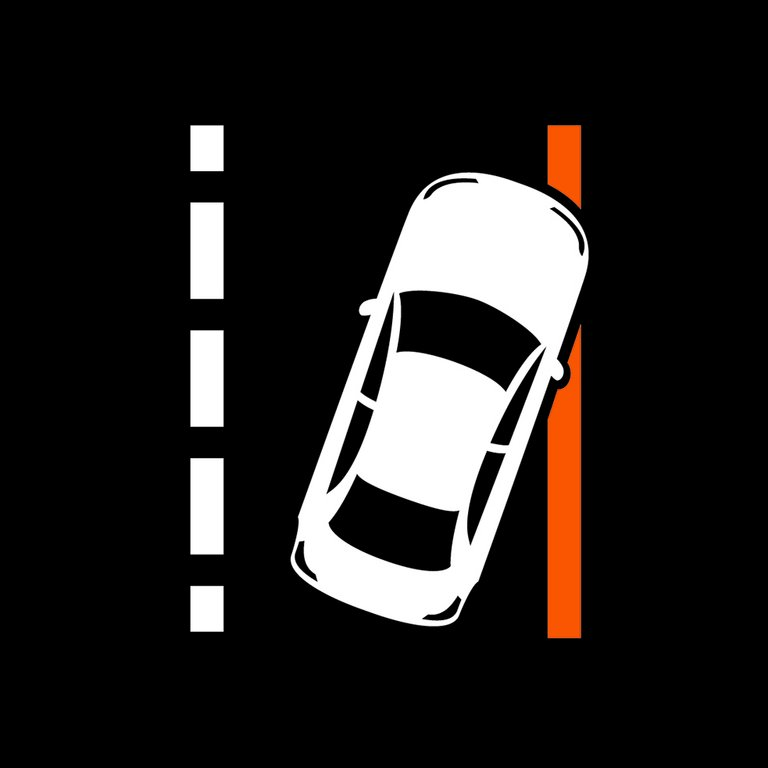
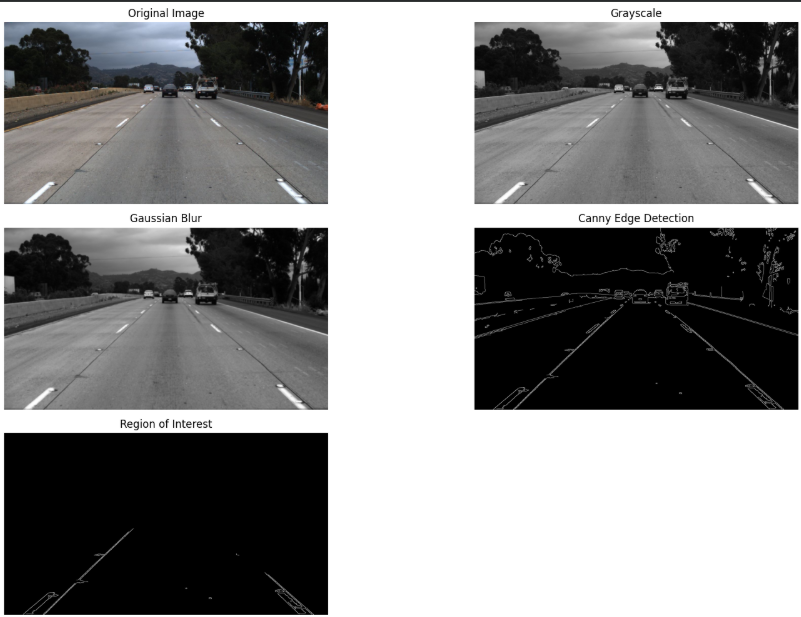
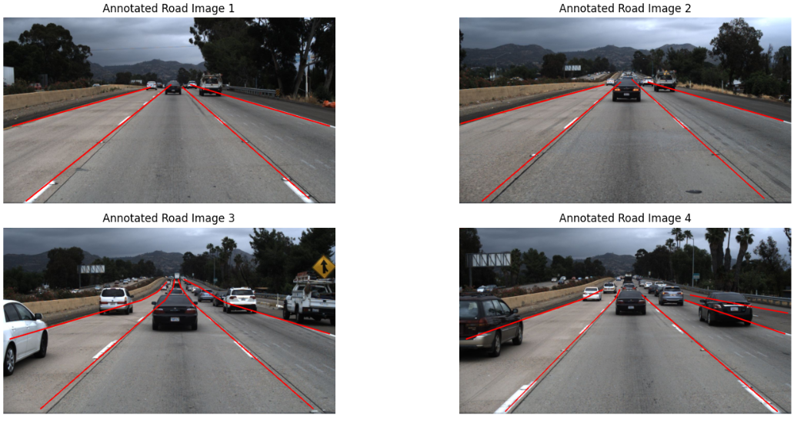
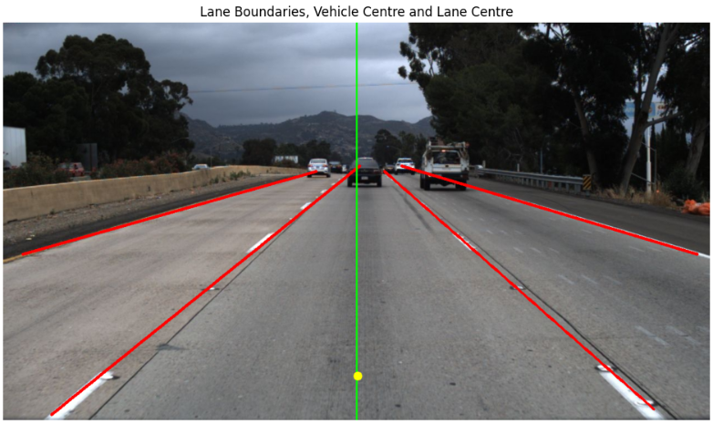
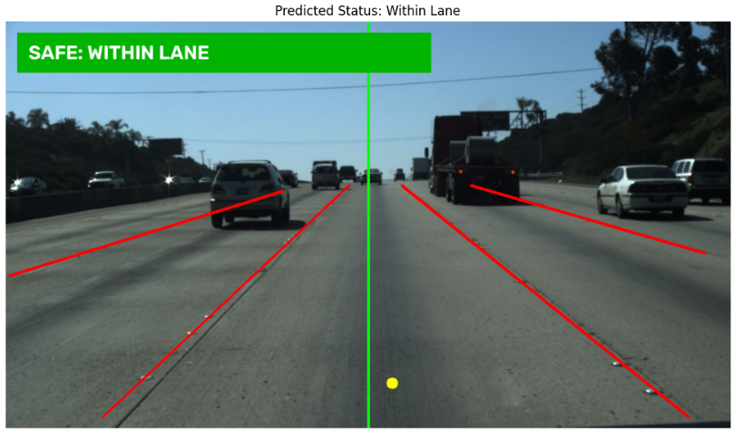
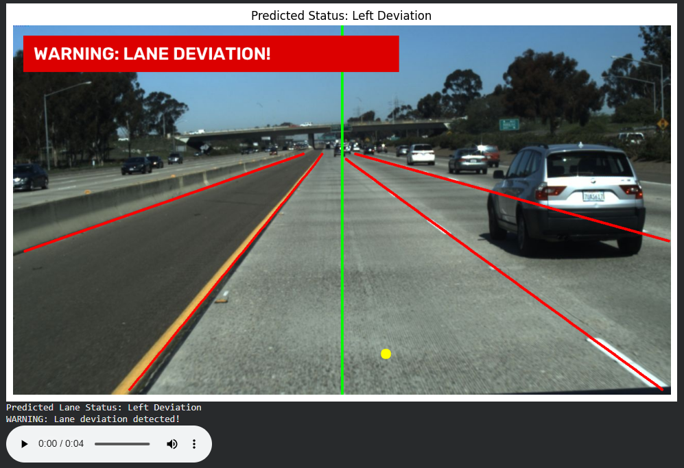

# 🚗 Lane Departure Warning System Using Machine Learning



## 📌 Project Overview

This project develops a Python-based **Lane Departure Warning System (LDWS)** using Machine Learning and Computer Vision concepts.

The system analyzes lane positions from road images and predicts whether a vehicle is staying within its lane or moving toward the lane boundaries.

The project uses the **TuSimple Lane Detection Dataset** to extract lane coordinates, calculate lane-related features, and train a Machine Learning model to classify lane status.

It also integrates **Google Text-to-Speech (gTTS)** to provide voice-based warnings when lane deviation is detected.

The main objective is to improve driver awareness by identifying potential lane departure and generating visual and audio alerts.

---
Applying Filters to extract Region of Intrest



---
Drawing Lane Boundaries 



---
## 🎯 Project Objectives

- Analyze road images and lane annotations.
- Extract left and right lane coordinates.
- Calculate lane center and vehicle center.
- Determine the vehicle's position relative to the lane.
- Train a Machine Learning model to classify lane status.
- Predict potential lane deviation.
- Display lane departure warning messages.
- Generate voice alerts using gTTS.

---

## 📂 Dataset

This project uses the TuSimple Lane Detection Dataset, which contains road images captured from a vehicle-mounted camera.

The dataset includes:

- Training images: 3,626
- Validation images: 358
- Testing images: 2,782
- Total: 6,766 images

The road images are used to extract lane-related features for the Lane Departure Warning System.

---

## ⚙️ Project Workflow

The project follows the workflow below:

1. Install and import the required Python libraries.
2. Download the TuSimple dataset using KaggleHub.
3. Load the road images and JSON annotation files.
4. Extract lane coordinates from the annotations.
5. Calculate left and right lane positions.
6. Calculate lane center and vehicle center.
7. Generate lane status labels.
8. Split the dataset into training and testing sets.
9. Train the Random Forest Classifier.
10. Evaluate the trained model.
11. Predict lane status for test samples.
12. Display lane information and warning messages.
13. Generate voice alerts using gTTS when lane deviation is predicted.

---

## 🧠 Lane Departure Prediction Logic

The lane departure prediction is based on the relationship between the vehicle center and the lane center.

### 1. Extract Lane Coordinates

The left and right lane positions are extracted from the TuSimple annotation files.

These coordinates represent the lane boundaries in the road image.

### 2. Calculate Lane Center

The lane center is calculated using the left and right lane positions.

```python
lane_center = (left_lane + right_lane) / 2
```

This represents the approximate center of the vehicle's lane.

### 3. Calculate Vehicle Center

The vehicle center is estimated using the horizontal center of the road image.

For an image with a width of 1280 pixels:

```python
vehicle_center = 1280 / 2
```

Therefore, the estimated vehicle center is 640 pixels.

### 4. Determine Lane Position

The vehicle center is compared with the lane center.

The difference between these values helps identify whether the vehicle is centered or shifted toward one side of the lane.

### 5. Generate Lane Status Labels

Based on the lane position, the system generates lane status labels:

- **Within Lane** – The vehicle is approximately centered within the lane.
- **Left Deviation** – The vehicle is shifted toward the left lane boundary.
- **Right Deviation** – The vehicle is shifted toward the right lane boundary.

These labels are used as target outputs for supervised Machine Learning.

### 6. Train the Machine Learning Model

The extracted lane-related features are used to train a **Random Forest Classifier**.

The dataset is divided into training and testing sets using `train_test_split()`.

The model learns the relationship between the lane features and the lane status labels.

### 7. Predict Lane Departure

After training, the model receives lane-related feature values and predicts the lane status.

The prediction identifies whether the vehicle is within the lane or deviating toward either side.

### 8. Generate Warning

If the predicted lane status indicates deviation, the system displays a lane departure warning.

This provides a visual indication that the vehicle may be moving away from its intended lane.

---
Calculated Lane and Vehicle Center



## 🔊 Voice Alert System

The project integrates **Google Text-to-Speech (gTTS)** to provide voice-based lane departure warnings.

When the Machine Learning model predicts lane deviation, the system converts a warning message into speech and plays the generated audio.

### Voice Alert Workflow

1. The trained model predicts the lane status.
2. The predicted status is checked for lane deviation.
3. If deviation is detected, gTTS converts the warning message into speech.
4. The generated audio alert is played.

Example voice warning:

**"Alert! Going off the lane."**

This feature provides an audio warning in addition to the visual lane departure message.

---

## 🤖 Machine Learning Algorithm

### Random Forest Classifier

The project uses a **Random Forest Classifier**, which is a supervised Machine Learning algorithm.

Random Forest combines multiple decision trees to make a classification prediction.

It is used to classify the vehicle's lane status based on the extracted lane-related features.

### Input Features

- Left lane position
- Right lane position
- Lane center
- Vehicle center

### Output Classes

- Within Lane
- Left Deviation
- Right Deviation

---

Outputs:

Within Lane Output:



Lane Departure Output:


## 📊 Model Evaluation

The model is evaluated using testing data.

The following metrics are used:

- Accuracy
- Precision
- Recall
- F1-Score
- Classification Report

These metrics help measure how well the model classifies lane status.

---

## 🛠️ Technologies Used

| Technology | Purpose |
|---|---|
| Python | Programming language |
| OpenCV | Image processing and visualization |
| NumPy | Numerical calculations |
| Pandas | Dataset handling |
| Matplotlib | Image and graph visualization |
| Scikit-learn | Machine Learning |
| Random Forest Classifier | Lane status prediction |
| KaggleHub | Dataset downloading |
| Joblib | Saving and loading the trained model |
| gTTS | Generating spoken warning messages |
| Google Colab | Development environment |

---

⭐ If you find this project useful, consider giving the repository a star.
